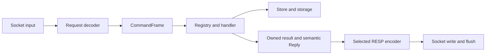

# Follow a request through kgcache

[Docs](../README.md) / [Contribute](README.md) / Architecture

Start here before changing command execution, reply ownership, or connection
lifecycle. The current server uses one joinable worker thread per connection
and shared, transaction-protected storage.

## Request and reply flow

The [request decoder](../../src/protocol/request_decoder.zig) accepts nonempty,
flat arrays of non-null bulk strings. It reports a consumed-byte count and a
[CommandFrame](../../src/protocol/command_frame.zig). The frame's name and
arguments borrow the input buffer. The caller owns the argument slice table.

Network input and AOF replay share this decoder. AOF writing uses a separate
[command encoder](../../src/protocol/resp_command_encoder.zig), independent
of reply mode.

The [command registry](../../src/commander.zig) owns typed names, arity, flags,
categories, and key metadata. Both dispatch and COMMAND introspection use it.
Handlers perform value-dependent validation and return semantic replies.
They do not write RESP bytes.

After execution, the connection reads the current protocol from
[ClientState](../../src/connection/client_state.zig). HELLO can change that
selection for its own reply and later commands. The encoders translate semantic
values into RESP2 or the supported RESP3 reply forms. Verbatim text becomes a
bulk string in RESP2 or a `txt:` verbatim value in RESP3; the RESP3 length counts
those four prefix bytes.

## Keep reply data alive

A Store read copies storage-backed data while its transaction is still locked.
The command result owns that copy through encoding and writer flush. Only then
does `Result.deinit` release it. Another client can change the stored key while
the first reply waits for its reader.

Cleanup order matters:

1. Finish or abandon the reply output.
2. Release the result and command owners.
3. Free the frame's argument table.
4. Reuse or release input bytes.

Encoding holds no storage lock. Validate the complete reply before writing any
bytes so a rejected length cannot leave partial protocol output.

A conditional mutation returns `MutationResult(T)`. Its outcome is `applied`
or `not_applied`; its value can still contain requested data. SET uses that
value for GET semantics even when a condition rejects the write. DEL uses a
`void` value. Handlers convert the result to an owned semantic reply.

## Connection ownership

| Owner | Lifetime and responsibility |
| --- | --- |
| [Server](../../src/server.zig) | Listener, shared object graph, and shutdown sequence |
| [ConnectionManager](../../src/connection/manager.zig) | Registration, worker handles, completion, joining, and reaping |
| [Connection](../../src/connection/session.zig) | One request loop borrowing Store, Logger, and stream |
| Worker | Close its stream exactly once when the session ends |

The manager reaps completed workers in bounded runtime passes. It joins every
remaining worker at shutdown. Storage backends own copied keys and string values
behind mutex-backed transactions. This design keeps lifecycle explicit, while
many connections can consume many threads or contend on storage locks.

CLIENT INFO/LIST copy owned report snapshots. They release collection and
report locks before sorting, formatting, or socket output. Each row is coherent
at its capture time; LIST is not one global snapshot. Slow report readers do
not retain the connection collection lock.

## Startup configuration

CLI and file settings share the startup arena supplied by Zig. The arena owns
file bytes, decoded strings, copied CLI values, and collected save rules.
Every supplied occurrence is validated, even when another occurrence replaces
it. CLI values are prepared before reading the file, then applied after it.

The final order is defaults, file, and CLI. All settings users finish before
Zig releases the arena. A caller that supplies its own arena must enforce the
same lifetime. This arena controls ownership; it does not impose a memory limit.
See [configuration](../reference/configuration.md) for the public input rules.

## Stop the server

The application supervises `Server.run` and a signal waiter with `std.Io.Select`.
The signal handler records SIGINT or SIGTERM and wakes the waiter. Normal
application code cancels and waits for the server.

The server stops accepting and stops cron, wakes client socket reads and writes,
and joins workers. Sessions finish releasing borrowed and owned request state
before their streams close. Persistence children are then reaped and accounted
for while backends and the borrowed logger remain alive.

Only after persistence is settled can the server close the journal and release
Store, Storage, and allocator-owned state. A runtime failure reaches the same
cleanup boundary. A requested signal is normal control flow; cleanup failure
still changes the process result. The detailed rules are in
[persistence lifecycle](persistence.md) and [error reporting](errors.md).

## Find the relevant source

| Area | Entry point |
| --- | --- |
| Process and server lifecycle | [main.zig](../../src/main.zig), [server.zig](../../src/server.zig) |
| Connections and reports | [connection/](../../src/connection) |
| Requests and wire replies | [protocol/](../../src/protocol) |
| Commands and schemas | [commander/](../../src/commander) |
| Store and storage backends | [store/](../../src/store), [storage/](../../src/storage) |
| Config loading and validation | [config/](../../src/config), [cli.zig](../../src/cli.zig) |
| Housekeeping and expiration | [cron.zig](../../src/cron.zig), [expiration.zig](../../src/expiration.zig) |
| Snapshots and journal | [persistence/](../../src/persistence), [persistence_state.zig](../../src/persistence_state.zig) |
| Snapshot codecs | [codec/](../../src/codec) |
| Unit discovery | [tests.zig](../../src/tests.zig) |

The server owns cache behavior and persistence. Future kgx platform integration
and a fixed event-worker design are separate work, not current capabilities.
The worker proposal is tracked in [#123](https://github.com/kgxlabs/kgcache/issues/123).
